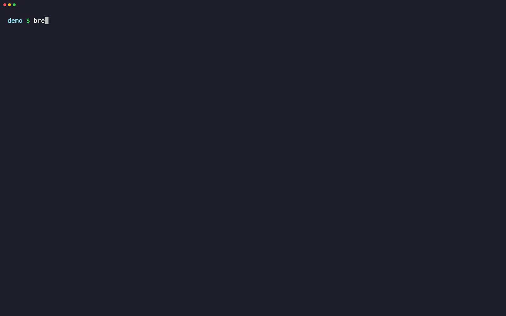

<h1 align="center">
  <picture>
    <source media="(prefers-color-scheme: dark)" srcset="site/public/icon-dark.svg">
    
  </picture>
  SafeSelect
</h1>

<h3 align="center">Read-only PostgreSQL &amp; MongoDB access for coding agents.</h3>

<p align="center">
  Debug with real database context, without exposing write tools.<br>
  Import your existing connections. Keep credentials out of the chat.
</p>

<p align="center">
  <a href="#quick-start"><strong>Get started →</strong></a> ·
  <a href="#see-it-in-action">Demo</a> ·
  <a href="#supported-agents">Agents</a> ·
  <a href="#security-and-quality-evidence">Security &amp; quality</a> ·
  <a href="#documentation">Docs</a> ·
  <a href="https://antonillos.github.io/safeselect/">Website</a>
</p>

<p align="center">
  <a href="https://github.com/antonillos/safeselect/actions/workflows/verify.yml"></a>
  <a href="docs/ci.md#crap-quality-report"></a>
  <a href="LICENSE"></a>
</p>

## Why SafeSelect?

Give your coding agent the database context it needs to investigate a bug,
understand a schema or inspect a query plan. SafeSelect exposes read-only tools
for **PostgreSQL and MongoDB**, with local policy and bounded results.

- **Debug with database context.** Discover tables, collections and indexes before
  reading the rows or documents relevant to your task.
- **Start with connections you already have.** Import from DBeaver, Docker Compose
  or MongoDB Compass, including SSH-backed connections.
- **Keep control of access.** Set project-specific access rules, row limits and
  timeouts. Passwords stay in macOS Keychain or environment variables.
- **Run locally.** The agent connects over MCP stdio, with no MCP network listener.
  SafeSelect enforces its read-only tool surface even when the configured
  database credentials allow writes.

> [!IMPORTANT]
> SafeSelect's read-only boundary covers its database tools. An agent's shell,
> other MCP servers and direct credentials remain outside that boundary.
> Use least-privilege database users and start with development data or a
> sanitized replica. See the [threat model and limits](docs/security-proof.md).

## See it in action

<p align="center">
  
</p>

From Homebrew to a connected agent: import a DBeaver connection, keep its password
in Keychain, and let OpenCode inspect an order through read-only tools.
See the [demo gallery](demo/README.md) for more clients, MongoDB and Linux onboarding.

## Quick Start

Run setup from your repository root. You need a PostgreSQL or MongoDB connection
and a **Java 17+ runtime** for database commands.

### 1. Install

<a id="homebrew-macos"></a>

On macOS with Homebrew:

```bash
brew install antonillos/tap/safeselect
```

For **Linux**, prebuilt binaries, asdf, Java setup or source builds, follow the
[installation guide](docs/install.md).

### 2. Import a connection

Choose the source you already use:

| Connection source | Command |
|---|---|
| DBeaver export | `safeselect import-dbeaver ~/Downloads/dbeaver-export.zip` |
| PostgreSQL in Docker Compose | `safeselect import-compose` |
| MongoDB Compass | `safeselect import-compass --path "$HOME/.config/MongoDB Compass"` |

Use your actual export or Compass directory, then follow the importer's driver
and password setup steps. Keep secrets out of project files and chat.
For a complete SSH-backed example, follow the [DBeaver → Codex walkthrough](docs/guides/dbeaver-codex.md).

### 3. Connect your agent

```bash
# Verify connectivity; this can open SSH tunnels and contact databases.
safeselect check

# Replace codex with opencode, or choose another supported client below.
safeselect agent install codex
safeselect agent status
```

If you have multiple environments, add `--environment <name>` to both `check`
and `agent install` to select the intended database. Without it, `check` tests
all environments; installation only infers a target when there is exactly one.

Open or restart your agent and approve the MCP server if prompted. Installation
uses user scope by default; add `--local` for project scope where supported.
See [client setup and scopes](docs/agents.md).

### 4. Try it

Ask your agent:

> Use SafeSelect to identify the connected backend. For PostgreSQL, list tables
> and describe one using catalog metadata. For MongoDB, list databases and
> collections only. Stop before reading rows or sampling documents.

**Success:** the agent reports the database identity and available tables or
collections without needing a database password in the conversation.
Then ask it to investigate a specific issue with a small, targeted read.
MongoDB schema inference samples documents, so include that step only when
you are ready to read data.

**Need help?** Run `safeselect doctor --environment <name>` and follow its next
step. Diagnostics can contact the database. See the
[connection diagnostics](docs/cli.md#connection-diagnostics) or
[agent recovery guide](docs/agents.md#agent-recovery-flow).

## Supported agents

OpenAI Codex · OpenCode · Claude Code · Cursor · Windsurf · GitHub Copilot · Gemini CLI

SafeSelect works with MCP clients over stdio. Built-in installation handles the
clients above; the [integration guide](docs/agents.md) covers configuration,
scopes and manual setup. Codex and OpenCode also receive four portable workflow
skills. After updating SafeSelect, run `safeselect agent upgrade <client>` and
reload your client.

## Security and quality evidence

SafeSelect validates requests against project policy before database execution.
Ordinary policy rejections return an error; serious security attempts and internal
validation or audit failures stop the server. Result limits and timeouts bound
reads, and query text is hashed for audit records.

The database security suites run against disposable PostgreSQL and MongoDB
fixtures. Rejection cases check the expected error and compare the resulting
database state with a baseline, so a rejected response alone is not enough to pass.

| What is checked | Inspect the evidence |
|---|---|
| SQL writes, stacked statements and side-effecting functions | [PostgreSQL security tests](tests/security_suite/real_postgres.rs) |
| MongoDB write stages, server-side JavaScript and access boundaries | [MongoDB security tests](tests/security_suite/real_mongodb.rs) |
| Malformed MCP requests, policy rejection and shutdown behavior | [MCP regression tests](tests/mcp_negative.rs) |
| Rust and Java complexity with test coverage | [CRAP report and CI artifacts](docs/ci.md#crap-quality-report) |
| Commit signatures and message format | [Commit Policy](docs/ci.md#commit-policy) |

See [how to verify a CI execution](docs/security-test-suite.md#verify-a-ci-execution)
for results tied to a specific commit. Test source describes the checks; a
successful matching run provides execution evidence. Pending or skipped suites
are unverified, and badges can refer to a different revision.

Read the [threat model and limits](docs/security-proof.md), the
[security model](docs/security.md), or the [architecture](docs/architecture.md)
for the scope of these controls.
For alternatives and tradeoffs, see the [database MCP comparison](docs/compare.md).

## Documentation

| I want to… | Start here |
|---|---|
| Install, update or uninstall | [Installation guide](docs/install.md) |
| Set up my coding agent | [AI agent integration](docs/agents.md) |
| Import an SSH-backed DBeaver connection | [DBeaver → Codex walkthrough](docs/guides/dbeaver-codex.md) |
| Watch examples | [Demo gallery](demo/README.md) · [Visual command gallery](docs/cli-gallery.md) |
| Find a command or MCP tool | [CLI reference](docs/cli.md) · [MCP tools](docs/agents.md#mcp-tools) |
| Configure policy, environments or passwords | [Configuration](docs/configuration.md) |
| Understand the security boundary | [Threat model and limits](docs/security-proof.md) · [Architecture](docs/architecture.md) |
| Inspect quality checks and security tests | [CI and CRAP report](docs/ci.md#crap-quality-report) · [Security test suite](docs/security-test-suite.md) |
| Find packages and directory listings | [Distribution](docs/distribution.md) |
| Build or contribute | [Contributing](CONTRIBUTING.md) · [Changelog](CHANGELOG.md) |

## Feedback and contributions

Have a setup problem or a feature request? [Open an issue](https://github.com/antonillos/safeselect/issues).
For setup feedback, include your client, OS and the step that failed; leave out
credentials, connection exports and database contents.
Report security vulnerabilities through the [security policy](SECURITY.md).

Contributions are welcome—see [Contributing](CONTRIBUTING.md) to get started.

## License

[MIT](LICENSE).
