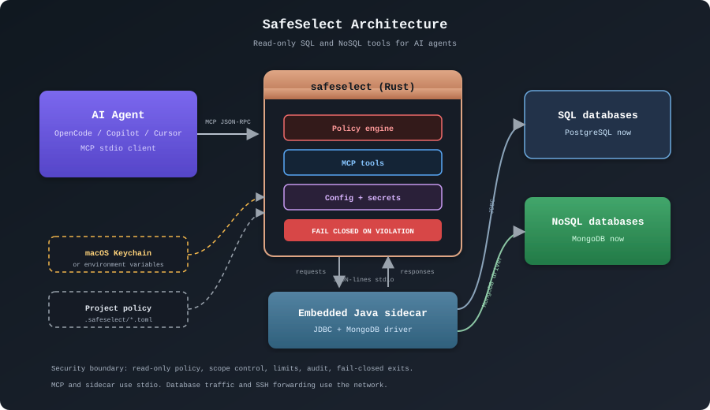

# Architecture

  

The agent talks to SafeSelect through MCP stdio. SafeSelect enforces policy in
Rust, stores secrets outside project files, and reaches PostgreSQL through JDBC
and MongoDB through its native driver in an embedded Java sidecar.

Both MCP and the Rust-to-Java JSON-lines channel use stdin/stdout, without
network listeners. Database connections still use the network, and configured
SSH tunnels can open local forwarding ports. The Java runtime is a separate
prerequisite; the sidecar JAR is embedded in the installed SafeSelect binary.

See the [security model](security.md) for enforcement details and the
[threat model](security-proof.md) for the boundary and its limits.
