# Visual command gallery

The CLI is easier to scan by task than as one long list. The [web command gallery](https://antonillos.github.io/safeselect/commands/) uses the same synthetic-demo captures. `query` is kept separate because it is a direct SQL workflow; agents should normally discover schema first through MCP tools.

<details>
<summary><strong>Import connections</strong> — Bring an existing DBeaver, Docker Compose or MongoDB Compass connection into the project.</summary>


#### `import-dbeaver`

Import a DBeaver export into .safeselect/.

```bash
safeselect import-dbeaver ~/Downloads/connections.zip
```

<p>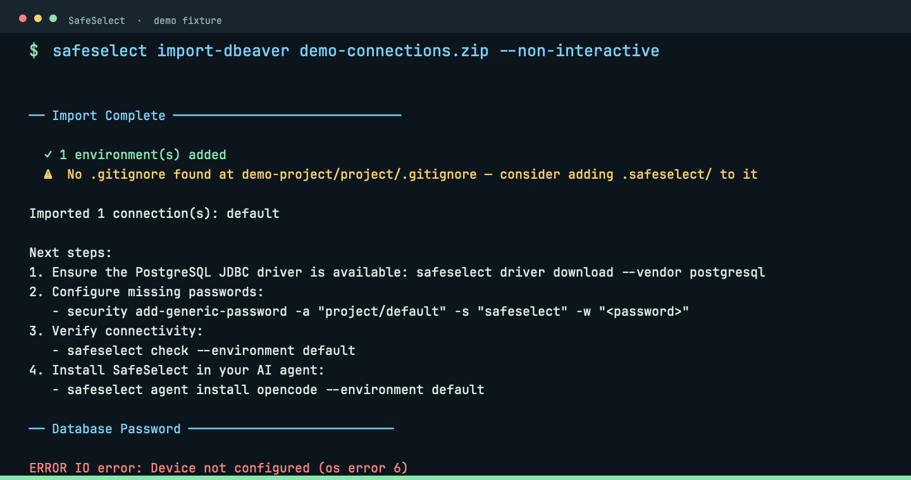</p>

_The importer keeps the connection shape while leaving passwords outside project files._

DBeaver uses the same interactive workflow as Compass: choose environments,
update/create/skip on reimport, and choose the database and SSH password sources.
Passwords can be kept in macOS Keychain, referenced through an exported variable,
or configured later; literal session-only passwords do not survive the import.
Updates preserve existing TLS, limits and password sources unless changed explicitly,
and never silently change shared bastion definitions. Connection checks are optional.
The local `.safeselect/dbeaver-imports.toml` index recognizes custom environment
names with password-independent fingerprints. Existing matching JDBC environments
are also recognized without an index.

With `--non-interactive`, imports never prompt, store exported passwords, overwrite
existing matching environments, or connect to databases. Distinct connections with
colliding names get unique names. Export the configured password variables before
connecting. The source SSL mode is preserved both with and without an SSH tunnel.


#### `import-compose`

Discover PostgreSQL services from Docker Compose.

Invalid YAML and duplicate keys are rejected. YAML errors omit source snippets
to avoid displaying nearby credentials.

```bash
safeselect import-compose --path .
```

<p>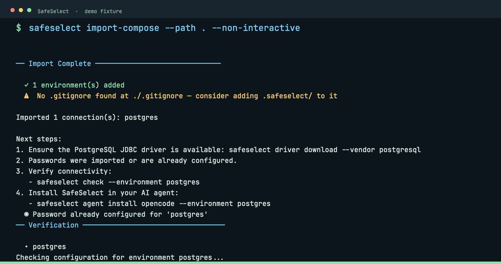</p>

_Compose discovery turns an existing local service into a project environment._


#### `import-compass`

Import MongoDB Compass connections.

```bash
safeselect import-compass --path "$HOME/.config/MongoDB Compass"
```

<p>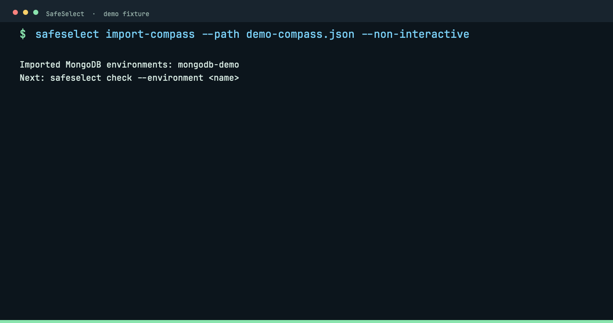</p>

_Compass imports preserve MongoDB connection details without exposing credentials._

Interactive import uses the same password choices for the database and SSH
bastion: keep the existing source, use a password present in the export, enter a
password with hidden input, reference an exported variable, or configure it later.
Imported passwords are always literal values, never interpreted as references.
Before accepting a literal password, SafeSelect asks where to keep it: macOS
Keychain or an environment variable available **only during that import process**.
Session-only passwords are not saved and cannot be exported to the parent shell;
future CLI/MCP commands need the variable exported by their launching shell.
No plaintext password is written to TOML, logs or terminal commands.

Suggested database variables include the project and environment, for example
`MYAPP_STAGING_DB_PASSWORD`. Bastion variables use only the environment, for
example `STAGING_SSH_PASSWORD`, so projects can share a bastion password reference.
Names are editable; existing references are not renamed. When sharing a launching
shell, choose distinct database prefixes for projects with identical or normalized
names, and distinct bastion variable names when their passwords differ.

Reimporting offers **update existing**, **create new**, or **skip**. Updates retain
password sources by default, preserve TLS and limits, and do not silently mutate
shared bastions. A local `.safeselect/compass-imports.toml` index recognizes custom
names from previous imports using password-independent connection fingerprints.
Non-interactive import skips existing connections and configures environment
references without automatically storing exported passwords. Connectivity checks
require confirmation after interactive import.

See the [synthetic Compass UX VHS](../demo/compass-import-ux/README.md).


</details>

<details>
<summary><strong>Prepare the project</strong> — Validate local policy, install drivers and connect an AI client without repeating configuration flags.</summary>


#### `config`

Validate, inspect and maintain project configuration.

```bash
safeselect config show --project demo --environment postgres
```

<p>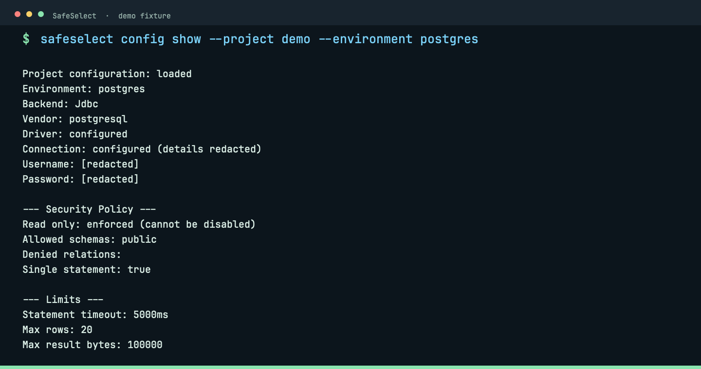</p>

_Configuration show reports a safe, redacted policy summary before the server starts._


#### `driver`

Register and verify JDBC drivers.

```bash
safeselect driver list
```

<p>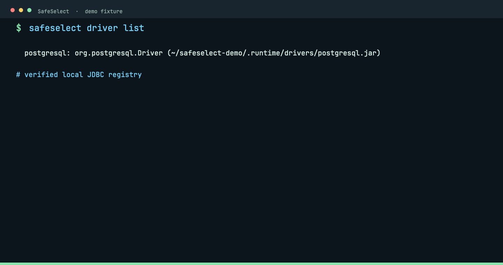</p>

_The driver registry shows the vendor and local verified artifact._


#### `agent`

Detect clients and install their MCP entry.

```bash
safeselect agent detect
```

<p>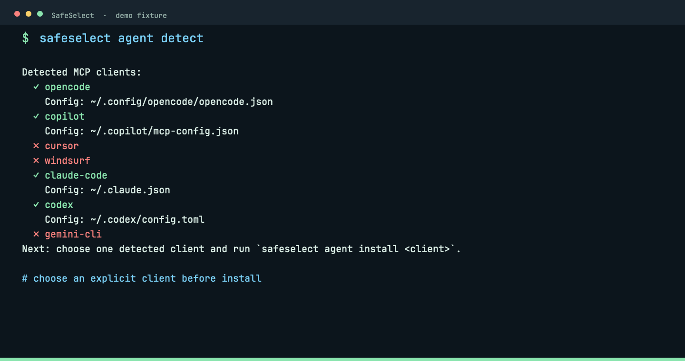</p>

_Detection lists available clients before an explicit project-scoped MCP install._


</details>

<details>
<summary><strong>Verify and diagnose</strong> — Check the complete path from project policy to the database, then inspect the effective PostgreSQL posture.</summary>


#### `check`

Test configuration, secrets, tunnels, sidecar and backend connectivity.

```bash
safeselect check
```

<p>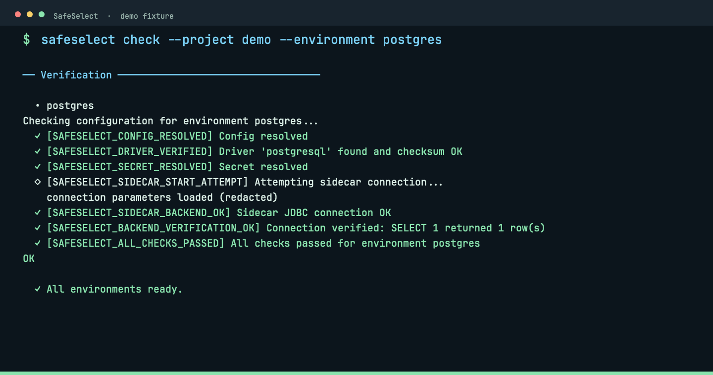</p>

_Checks follow convention and inspect every environment unless one is selected deliberately._


#### `doctor`

Print concise findings with stable diagnostic codes.

```bash
safeselect doctor
```

<p>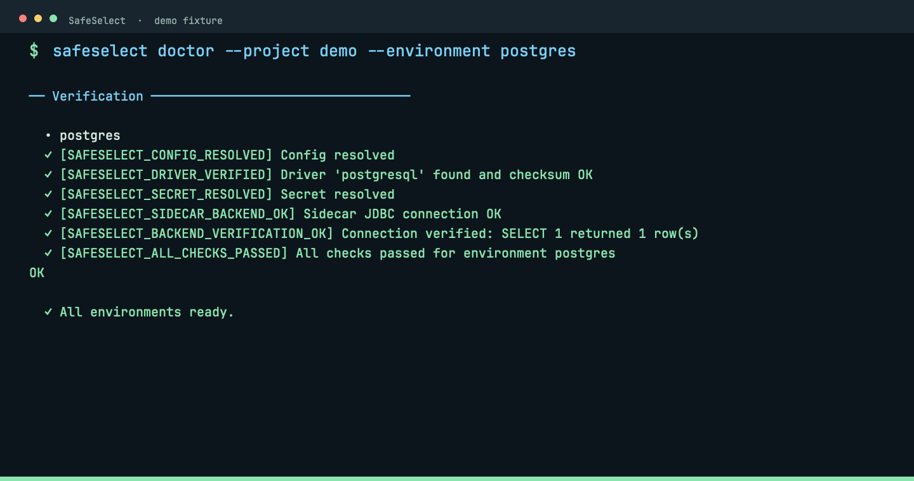</p>

_Doctor turns a failed connection into a short next action instead of a log wall._


#### `posture`

Inspect the effective PostgreSQL security posture.

```bash
safeselect posture --strict
```

<p>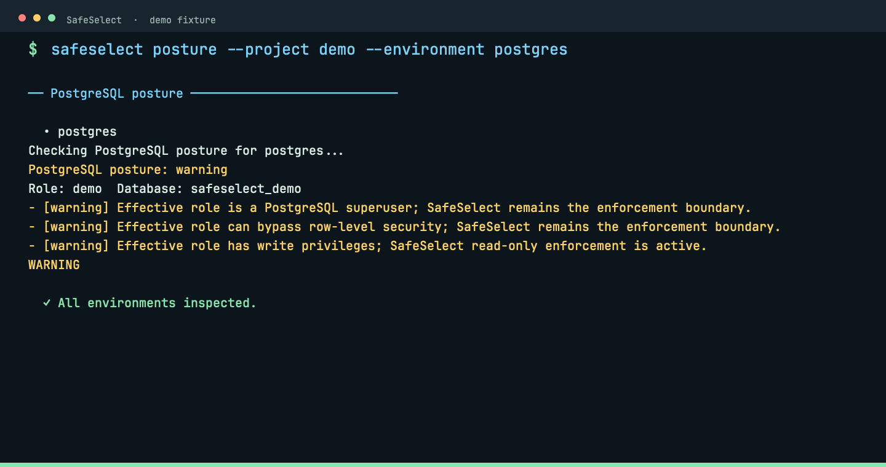</p>

_Posture shows the effective read-only policy, limits and database posture before agent use._


</details>

<details>
<summary><strong>Manage a connection</strong> — Start the local MCP server or exercise the temporary connection lifecycle directly.</summary>


#### `serve`

Start the local MCP server for a project environment.

```bash
safeselect serve
```

<p>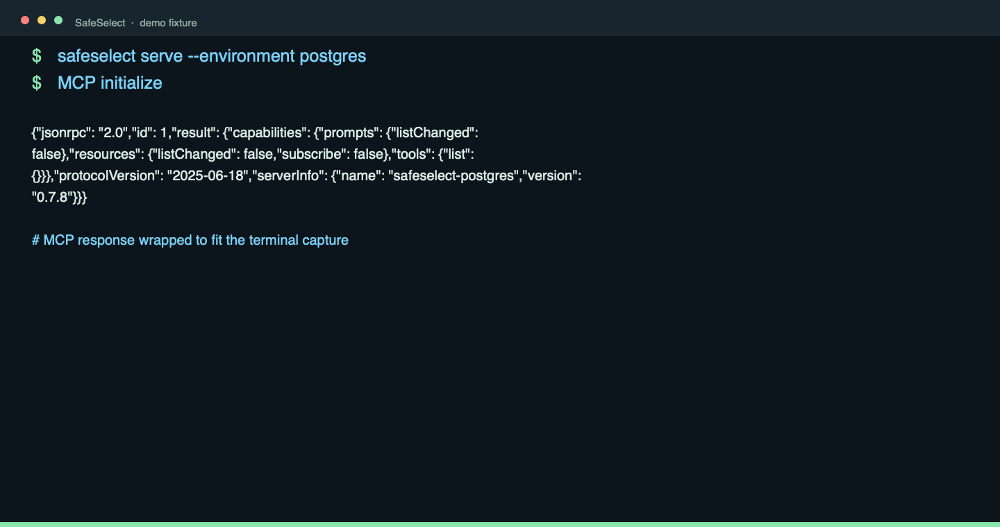</p>

_The server speaks local stdio: the MCP initialize response exposes SafeSelect capabilities, not a network listener._


#### `connect`

Test a temporary JDBC connection.

```bash
safeselect connect
```

<p>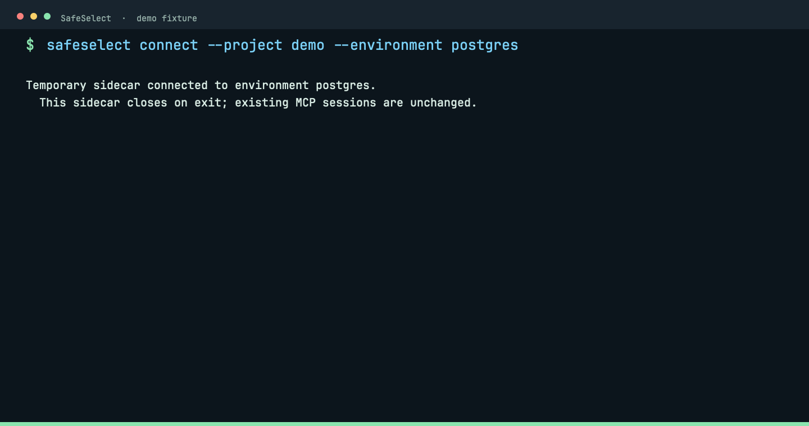</p>

_Connect verifies the temporary JDBC sidecar against the live fixture without taking over an active MCP session._


#### `disconnect`

Close a temporary JDBC connection.

```bash
safeselect disconnect
```

<p>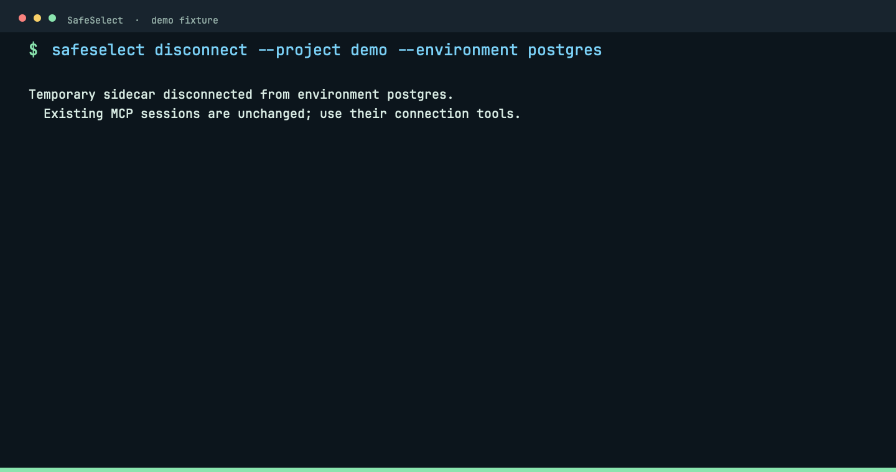</p>

_Disconnect cleanly closes the temporary JDBC sidecar and reports the completed lifecycle step._


#### `reconnect`

Verify connectivity using a new, temporary sidecar.

```bash
safeselect reconnect
```

<p>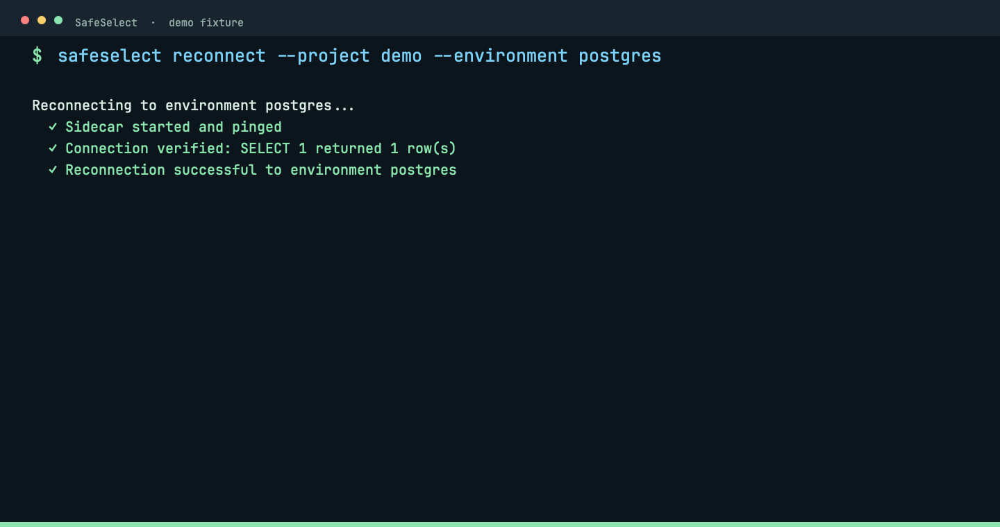</p>

_CLI reconnect verifies each selected environment and shuts down its temporary
sidecar before exiting. It checks all environments by default and does not
restart an agent's MCP session; use that session's MCP `reconnect` tool instead._


</details>


<details>
<summary><strong>Explore SQL: discover, inspect and diagnose</strong> — Use query when you already know the bounded SQL you want to inspect. Agents should normally discover schema first through MCP tools.</summary>


#### `query`

Execute one bounded read-only SQL statement and display its results.

```bash
safeselect query --sql "SELECT order_id, status, subtotal FROM public.demo_orders WHERE status = 'paid' LIMIT 3"
```

<p>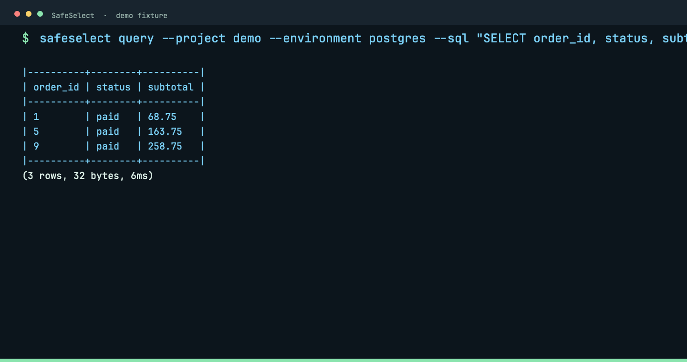</p>

_The bounded SQL request returns three synthetic fixture rows with row and byte counts; writes remain rejected._


#### `list_tables` (MCP)

Discover PostgreSQL tables through MCP.

```text
list_tables({"schema":"public"})
```

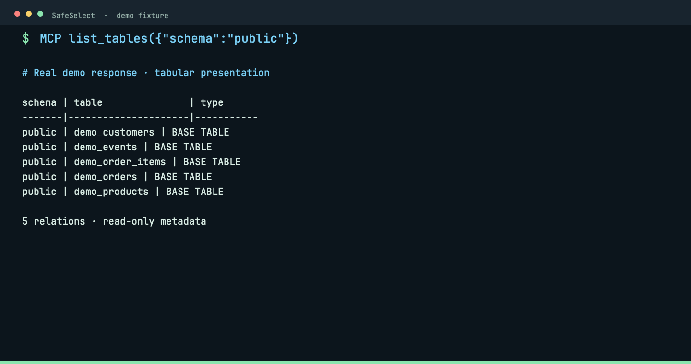

Real MCP response, formatted as a table: five synthetic relations in public. Discover exact names before inspecting columns.

#### `describe_table` (MCP)

Inspect column names, types and nullability through MCP.

```text
describe_table({"schema":"public","table":"demo_orders"})
```

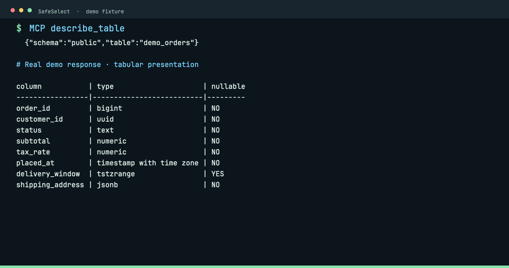

Real MCP response, formatted as a table: eight columns including UUID, JSONB and a timestamp range. No data rows are queried.

#### `get_maintenance_diagnostics` (MCP)

Inspect ANALYZE and VACUUM signals without running maintenance.

```text
get_maintenance_diagnostics({"schema":"public"})
```

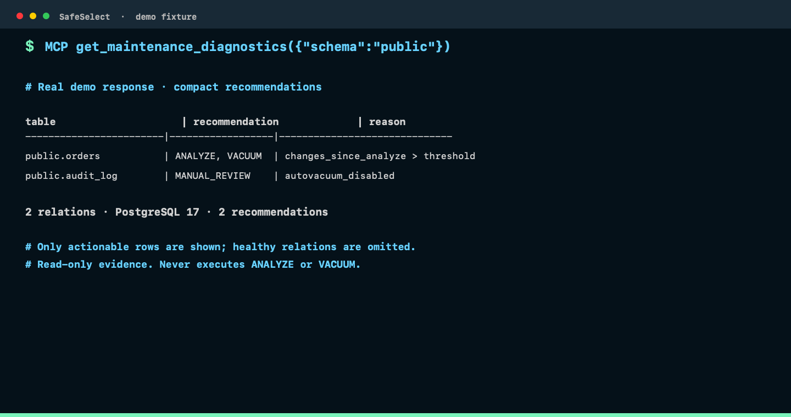

Real MCP response: a compact table containing only relations with an ANALYZE, VACUUM, or manual-review recommendation, plus summary counts. This read-only diagnostic never executes maintenance.

</details>

<details>
<summary><strong>Explore NoSQL: discover, infer and read</strong> — List databases and collections, sample documents to infer their structure, then run a bounded query.</summary>

#### `list_databases` (MCP)

Discover MongoDB databases through MCP.

```text
list_databases()
```

<p>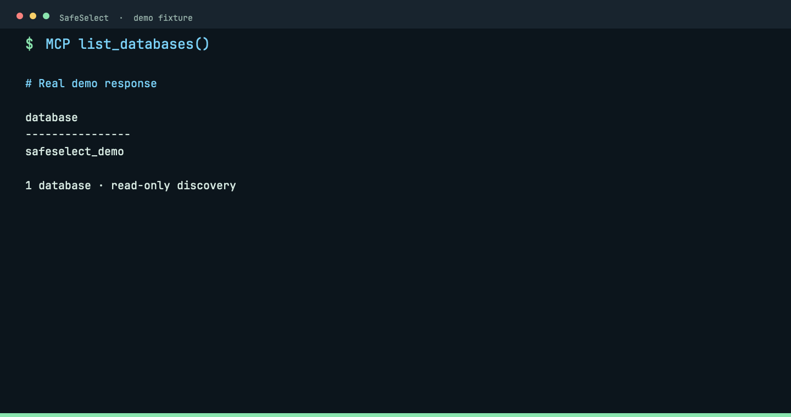</p>

_Real MCP response: the isolated demo exposes one allowed database. Choose it before discovering collections._

#### `list_collections` (MCP)

Discover collections in an allowed MongoDB database.

```text
list_collections({"database":"safeselect_demo"})
```

<p>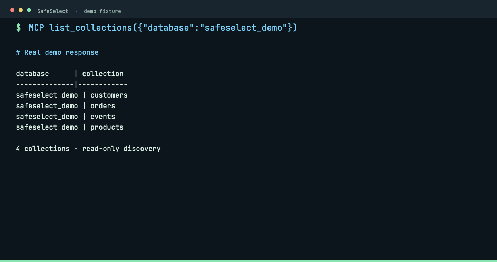</p>

_Real MCP response: four synthetic collections are listed without reading documents._

#### `discover_document_schema` (MCP)

Infer frequent fields and types from a bounded MongoDB sample.

```text
discover_document_schema({"database":"safeselect_demo","collection":"orders","sample_size":5})
```

<p>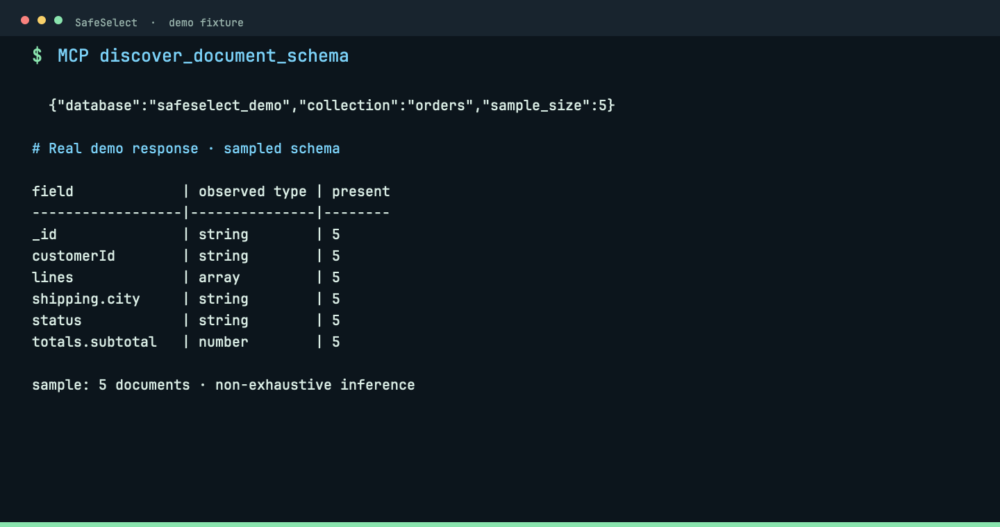</p>

_Real MCP response: sampled fields and observed types guide the next bounded read; inference is explicitly non-exhaustive._

#### `find_documents` (MCP)

Read bounded MongoDB documents with an explicit filter.

```text
find_documents({"database":"safeselect_demo","collection":"orders","filter":{"status":"paid"},"limit":3})
```

<p>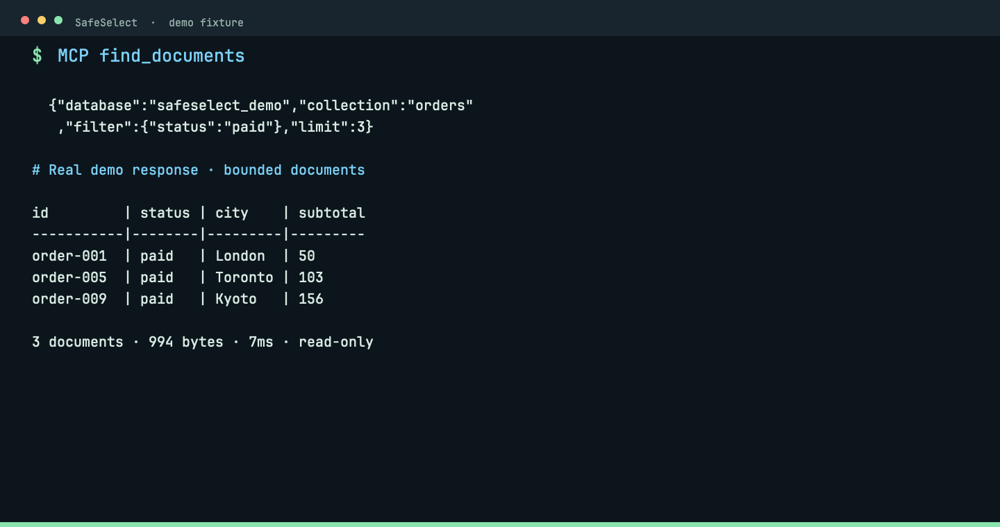</p>

_Real MCP response: three paid orders, 994 bytes, returned in 7ms. The filter and limit keep the read bounded._

</details>

Use `safeselect --help` or a command-specific `--help` for the full CLI.
